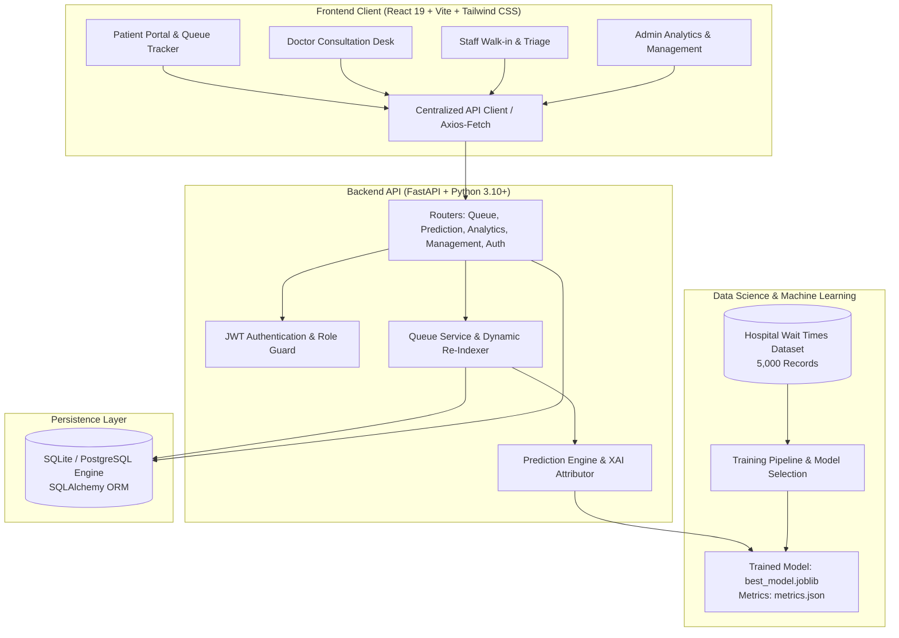

# MediWait AI 🏥⏱️
### Intelligent Hospital Waiting Time Prediction & OPD Queue Management Engine

[](https://www.python.org/)
[](https://fastapi.tiangolo.com/)
[](https://react.dev/)
[](https://vitejs.dev/)
[](https://tailwindcss.com/)
[](https://scikit-learn.org/)
[](LICENSE)

---

## 📌 Project Overview

**MediWait AI** is an intelligent, full-stack clinical operations and queue management platform designed to eliminate unpredictable waiting times in Outpatient Departments (OPD) and clinics. 

By combining **machine learning regression models**, **real-time queue re-indexing algorithms**, and **Explainable AI (XAI)**, MediWait AI delivers accurate wait-time forecasts, transparent factor attributions ("Why This Wait?"), dynamic triage overrides, and multi-role clinical workflows for patients, physicians, triage staff, and hospital administrators.

---

## ⚠️ Problem Statement

In modern outpatient healthcare facilities:
* **Uncertain Waiting Times:** Patients routinely experience long, unpredictable wait times without visibility into their position or estimated consultation time, inducing significant anxiety and dissatisfaction.
* **Triage & Emergency Disruptions:** Unscheduled emergency arrivals cause sudden queue delays that traditional static token displays fail to recalculate or explain.
* **Workload Imbalances:** Outpatient clinics face uneven patient-to-doctor ratios, resulting in idle physicians in certain wings while others face acute bottlenecks.
* **Lack of Operational Visibility:** Clinical leadership lacks centralized, live telemetry on department throughput, active consultation rates, and queue health metrics.

---

## 🎯 Objectives

1. **Accurate Waiting Time Inference:** Deliver sub-second, highly accurate wait time predictions based on dynamic clinical variables (queue depth, physician availability, emergency cases, time-of-day surge, and specialty consultation baselines).
2. **Transparent Explainable AI (XAI):** Provide patients and staff with actionable factor attribution breakdowns explaining the specific drivers behind any predicted delay.
3. **Automated Dynamic Queue Synchronization:** Continuously re-index patient queue positions and recalculate waiting times across all waiting patients whenever patients are called, completed, cancelled, or emergency-escalated.
4. **Unified Role-Based Experience:** Deliver tailored interfaces for **Patients**, **Attending Doctors**, **Front-Desk/Triage Staff**, and **Hospital Administrators**.
5. **High Operational Reliability:** Ensure decoupled architecture, robust error boundaries, and scalable REST API endpoints.

---

## 🌟 Main Features

### 1. 🧑‍🤝‍🧑 Patient Experience & Real-Time Queue Tracker
* **Digital Token Allocation:** Instant token generation across hospital departments (e.g., Cardiology `A-127`, Orthopedics `B-201`).
* **Live Queue Progress:** Real-time visibility into the patient's exact position in line, number of patients ahead, assigned consulting room, and estimated waiting minutes.
* **"Why This Wait?" Explainable AI:** A dedicated diagnostic modal breaking down exact contributors: queue size, active doctors, emergency triage additions, and peak hour influx.
* **Notification Stream:** Real-time updates on consultation status, approaching turn alerts, and emergency delay notices.

### 2. 👨‍⚕️ Doctor Consultation Portal
* **Live Patient Callout:** One-click patient summoning with automated room guidance dispatch.
* **Active Consultation Timer:** Real-time tracking of active consultation durations against department baselines.
* **Consultation Completion & Automatic Advancing:** Triggering instant queue recalculation and next patient queuing.
* **Direct Emergency Escalation:** Immediate flagging of critical triage cases requiring priority consultation.

### 3. 📋 Staff & Nurse Triage Desk
* **Rapid Patient Registration:** Seamless walk-in intake capturing MRN, age, gender, contact, and presenting department.
* **Priority Triage Controls:** Triage classification (Normal vs. Emergency) with automatic queue bumping.
* **Multi-Department Queue Oversight:** Consolidated operational queue monitoring across all hospital wings.

### 4. 📊 Admin Command & Analytics Center
* **Hospital-Wide Live KPIs:** Real-time metrics for total daily registrations, active waiting patients, patients in consultation, doctor availability ratio, active emergency counts, and mean wait times.
* **Department Workload Analytics:** Interactive graphical comparisons of queue depth, doctor allocations, and average consultation durations using Recharts.
* **Doctor & Department Roster Management:** Dynamic doctor availability toggling, department workload reassignment, and active status controls.
* **Operational Alert Center:** Automated threshold alarms flagging departments experiencing elevated wait times or high emergency volumes.

---

## 🏗️ System Architecture



---

## 🧠 Data Science & Machine Learning Implementation

The predictive intelligence in MediWait AI is powered by supervised regression models rigorously trained, validated, and evaluated against realistic clinical operational distributions.

### 1. Verified Dataset Details
* **Dataset File:** `ml/datasets/hospital_wait_times.csv`
* **Dataset Generation Script:** `ml/datasets/generate_dataset.py`
* **Total Observations:** **5,000** records
* **Train / Test Partition:** **4,000** training samples (80%) / **1,000** test samples (20%)
* **Target Feature:** `actual_wait_time` (continuous, measured in minutes)

### 2. Feature Engineering Pipeline
The prediction engine extracts and derives 15 clinical operational features:
* **Raw Features:** `queue_length`, `doctor_available`, `emergency_cases`, `avg_consultation_time`, `patient_count`, `time_of_day` (0-23), `day_of_week` (0-6), `is_holiday` (0/1), `department`.
* **Domain-Engineered Features:**
  * `doctor_to_patient_ratio`: $\frac{\text{doctor\_available}}{\max(\text{queue\_length}, 1)}$
  * `department_load`: $\text{queue\_length} \times \text{avg\_consultation\_time}$
  * `doctor_workload`: $\frac{\text{patient\_count}}{\max(\text{doctor\_available}, 1)}$
  * `emergency_ratio`: $\frac{\text{emergency\_cases}}{\max(\text{patient\_count}, 1)}$
  * `peak_hour_flag`: Indicator for morning peak (9:00 - 11:00) and afternoon peak (15:00 - 17:00)
  * `weekend_flag`: Indicator for Saturday and Sunday operations

### 3. Model Benchmark & Evaluation
Multiple regression algorithms were trained and benchmarked using 5-fold cross-validation. The performance metrics verified from `ml/models/metrics.json` are:

| Model | MAE (min) | RMSE (min) | $R^2$ Score | Accuracy (%) | Status |
| :--- | :---: | :---: | :---: | :---: | :---: |
| **Gradient Boosting Regressor** | **2.88** | **4.43** | **0.9946** | **99.5%** | 🏆 **Production Best** |
| **XGBoost Regressor** | 2.97 | 5.69 | 0.9911 | 99.1% | Evaluated |
| **Random Forest Regressor** | 3.52 | 6.18 | 0.9894 | 98.9% | Evaluated |
| **Decision Tree Regressor** | 5.25 | 7.77 | 0.9833 | 98.3% | Evaluated |
| **Linear Regression** | 7.92 | 13.10 | 0.9526 | 95.3% | Baseline |

### 4. Feature Importance Hierarchy
Feature importance analysis reveals the primary drivers of hospital wait times:
1. `doctor_to_patient_ratio`: **63.27%**
2. `department_load`: **26.36%**
3. `doctor_available`: **3.20%**
4. `avg_consultation_time`: **2.62%**
5. `emergency_cases`: **2.01%**
6. `emergency_ratio`: **1.64%**
7. `doctor_workload`: **0.71%**

### 5. Department Operational Baselines
* **Cardiology:** Average Wait: 51.2 min | Avg Queue: 7.5 patients | Consultation: 14.1 min | Avg Doctors: 3.7
* **Orthopedics:** Average Wait: 66.1 min | Avg Queue: 9.5 patients | Consultation: 13.1 min | Avg Doctors: 2.9
* **General Medicine:** Average Wait: 31.0 min | Avg Queue: 7.5 patients | Consultation: 10.0 min | Avg Doctors: 3.7
* **ENT:** Average Wait: 96.9 min | Avg Queue: 14.0 patients | Consultation: 9.0 min | Avg Doctors: 1.8
* **Dermatology:** Average Wait: 83.2 min | Avg Queue: 13.6 patients | Consultation: 8.0 min | Avg Doctors: 1.8

---

## 💻 Technology Stack

### Backend Stack
* **Language & Runtime:** Python 3.10+
* **Framework:** FastAPI (`>=0.110.0`)
* **ASGI Server:** Uvicorn (`>=0.28.0`)
* **ORM & Database:** SQLAlchemy (`>=2.0.0`), SQLite (default) / PostgreSQL
* **Schema Validation:** Pydantic v2 (`>=2.0.0`)
* **Authentication:** PyJWT (`>=2.8.0`) with SHA-256 password salting
* **Machine Learning:** Scikit-Learn (`>=1.4.0`), XGBoost (`>=2.0.0`), Pandas (`>=2.2.0`), NumPy (`>=1.26.0`), Joblib (`>=1.3.0`)
* **Automated Testing:** Pytest (`>=9.0.0`), FastAPI TestClient, in-memory SQLite isolation

### Frontend Stack
* **Framework:** React 19 (`^19.2.8`)
* **Bundler & Build Tool:** Vite 8 (`^8.2.2`)
* **Styling:** Tailwind CSS (`^3.4.17`), PostCSS, Autoprefixer
* **Data Visualization:** Recharts (`^3.10.1`)
* **Icons:** Lucide React (`^1.42.0`)
* **Visual Effects:** Canvas Confetti (`^1.9.4`)

---

## 📂 Project Structure

```text
mediwait-ai/
├── .env.example                     # Environment configuration template
├── .gitignore                       # Production Git ignore rules
├── README.md                        # Project documentation
│
├── backend/
│   ├── mediwait.db                  # Local development SQLite database (git-ignored)
│   ├── requirements.txt             # Python backend dependencies
│   └── app/
│       ├── main.py                  # FastAPI application entrypoint & middleware
│       ├── database/
│       │   ├── connection.py        # SQLAlchemy engine & session generator
│       │   └── seed.py              # Clinical seed database script
│       ├── ml/
│       │   ├── best_model.joblib    # Serialized Gradient Boosting model artifact
│       │   ├── metrics.json         # Evaluation metrics & department statistics
│       │   └── prediction_engine.py # Inference pipeline & XAI attribution logic
│       ├── models/
│       │   ├── __init__.py
│       │   └── all_models.py        # SQLAlchemy ORM entity models
│       ├── routers/
│       │   ├── analytics.py         # Admin KPI & department analytics endpoints
│       │   ├── auth.py              # Authentication & demo role switching
│       │   ├── management.py        # Doctors & departments management endpoints
│       │   ├── prediction.py        # Prediction & simulation endpoints
│       │   └── queue.py             # Queue operations, triage & recalculation
│       ├── schemas/
│       │   └── schemas.py           # Pydantic request/response models
│       ├── services/
│       │   ├── __init__.py
│       │   └── queue_service.py     # Queue synchronization & statistics service
│       ├── tests/
│       │   ├── __init__.py
│       │   ├── test_patient_registration_tracking.py
│       │   └── test_queue_synchronization.py
│       └── utils/
│           └── auth.py              # JWT token generator & security dependencies
│
├── frontend/
│   ├── index.html                   # HTML entrypoint
│   ├── package.json                 # Frontend package manifest
│   ├── package-lock.json            # Exact lockfile for frontend dependencies
│   ├── postcss.config.js            # PostCSS configuration
│   ├── tailwind.config.js           # Tailwind CSS design system tokens
│   ├── vite.config.js               # Vite bundler configuration
│   ├── public/                      # Static brand assets and SVGs
│   └── src/
│       ├── main.jsx                 # React root renderer
│       ├── App.jsx                  # Main view switcher and top-level layout
│       ├── App.css                  # Custom styling overrides
│       ├── index.css                # Tailwind utility directives
│       ├── components/
│       │   ├── AdminLayout.jsx      # Admin command center & analytics view
│       │   ├── DepartmentsManagement.jsx # Department roster & workload rebalancing
│       │   ├── DoctorsManagement.jsx     # Doctor status & allocation management
│       │   ├── DoctorView.jsx       # Doctor clinical consultation interface
│       │   ├── FeedbackModal.jsx    # Patient experience rating modal
│       │   ├── Navbar.jsx           # Top navigation bar with role switcher
│       │   ├── PatientView.jsx      # Patient queue tracker & token display
│       │   ├── QueueProgressTracker.jsx # Real-time position step indicator
│       │   ├── RegisterPatientModal.jsx # Walk-in patient intake modal
│       │   ├── StaffView.jsx        # Front desk triage & queue dispatching
│       │   └── WhyThisWaitModal.jsx # Explainable AI attribution modal
│       └── services/
│           └── api.js               # Centralized REST API client
│
└── ml/
    ├── datasets/
    │   ├── generate_dataset.py      # Synthetic operational dataset generator
    │   └── hospital_wait_times.csv  # 5,000-row clinical operational dataset
    ├── models/
    │   ├── best_model.joblib        # Model artifact
    │   └── metrics.json             # Model metrics
    └── training/
        └── train_models.py          # Multi-model training and evaluation script
```

---

## 🚀 Installation & Setup Guide

### Prerequisites
* **Python 3.10+**
* **Node.js 18+** & **npm**
* **Git**

---

### Step 1: Clone the Repository
```bash
git clone https://github.com/praveenr18/MediWait-AI-ds-project.git
cd MediWait-AI-ds-project
```

---

### Step 2: Backend Setup & Execution

1. **Navigate to the backend directory:**
   ```bash
   cd backend
   ```

2. **Create and activate a Python virtual environment:**
   ```bash
   # On Windows:
   python -m venv venv
   .\venv\Scripts\activate

   # On macOS/Linux:
   python3 -m venv venv
   source venv/bin/activate
   ```

3. **Install dependencies:**
   ```bash
   pip install -r requirements.txt
   ```

4. **Initialize and Seed the Database:**
   ```bash
   # The database automatically initializes on startup, or you can run:
   python -m app.database.seed
   ```

5. **Start the FastAPI Backend Server:**
   ```bash
   uvicorn app.main:app --reload --host 0.0.0.0 --port 8000
   ```
   The backend server will run at `http://localhost:8000`.

---

### Step 3: Frontend Setup & Execution

1. **Open a new terminal and navigate to the frontend directory:**
   ```bash
   cd frontend
   ```

2. **Install Node packages:**
   ```bash
   npm install
   ```

3. **Start the Vite Development Server:**
   ```bash
   npm run dev
   ```
   The frontend application will run at `http://localhost:5173`.

---

### Step 4: Running Backend Automated Tests

To execute the test suite (testing patient registration, queue progress, dynamic re-indexing, emergency escalation, and multi-doctor coordination):

```bash
# From the backend directory with virtual environment activated:
pytest app/tests/ -v
```

---

## 📖 API Documentation

FastAPI provides automated, interactive API documentation out-of-the-box:

* **Swagger UI:** [http://localhost:8000/docs](http://localhost:8000/docs)
* **ReDoc UI:** [http://localhost:8000/redoc](http://localhost:8000/redoc)
* **API Health Check:** `GET http://localhost:8000/api/health`

### Key Endpoints Overview

| Method | Endpoint | Description |
| :--- | :--- | :--- |
| `POST` | `/api/auth/login` | Authenticate user & issue JWT bearer token |
| `GET` | `/api/auth/demo-users` | Fetch demo accounts for role switching |
| `GET` | `/api/queue` | Retrieve active queue with filters by department |
| `POST` | `/api/queue/register` | Register walk-in patient and issue queue token |
| `POST` | `/api/queue/{id}/call` | Call patient into doctor consultation room |
| `POST` | `/api/queue/{id}/complete` | Mark consultation completed & recalculate queue |
| `POST` | `/api/queue/{id}/emergency` | Escalate patient to emergency triage priority |
| `POST` | `/api/prediction/predict` | Generate real-time wait prediction & XAI attribution |
| `GET` | `/api/analytics/kpis` | Hospital-wide executive KPIs & metrics |
| `GET` | `/api/management/departments` | Full department roster with live workload metrics |
| `GET` | `/api/management/doctors` | Full doctor roster with live availability |

---

## 🔮 Future Enhancements

* **WebSockets / Server-Sent Events (SSE):** Push instant queue changes to patient smartphones without polling.
* **SMS & WhatsApp Gateway Integration:** Twilio / WhatsApp Business notifications when the patient is 2 turns away.
* **Intelligent Clinical Symptom Triage:** NLP-assisted symptom intake to recommend optimal department routing.
* **Federated Multi-Hospital Load Dispatching:** Dynamic load-balancing across multiple regional hospitals during surge events.
* **Automated Model Retraining:** Continuous learning pipeline retraining on actual completed consultation logs.

---

## 📄 License

This project is licensed under the MIT License - see the LICENSE file for details.
